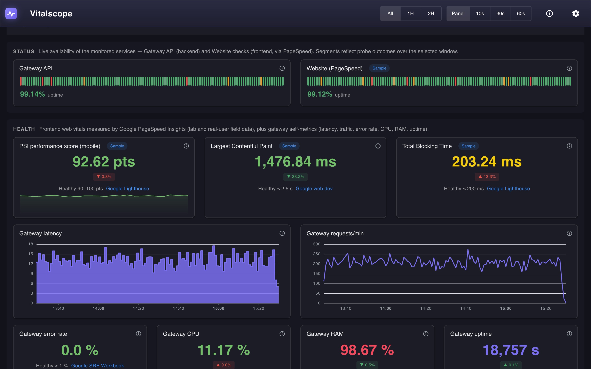

# Vitalscope — Web Vitals & Gateway Health Dashboard

Vitalscope is a self-hosted status page and health dashboard for a web platform: it shows live availability, frontend Web Vitals measured by [Google PageSpeed Insights](https://developers.google.com/speed/pagespeed/insights/), gateway self-metrics, and metrics pushed by any Connected App through a plug-and-play ingest endpoint.



## Contents

1. [Use case: monitor an e-commerce](#use-case-monitor-an-e-commerce)
2. [Step 1 — Run it (2 min)](#step-1--run-it-2-min)
3. [Step 2 — Connect your website](#step-2--connect-your-website)
4. [Step 3 — Connect your apps](#step-3--connect-your-apps)
5. [Integration example: shop-api](#integration-example-shop-api)
6. [Customize panels](#customize-panels)
7. [Configuration, environment variables & tokens](#configuration-environment-variables--tokens)
8. [Motivation](#motivation)
9. [Architecture](#architecture)
10. [Technologies](#technologies)
11. [Original project (charting exercise)](#original-project-charting-exercise)

## Use case: monitor an e-commerce

You run an online store with a web storefront and a Node.js checkout API. You want one screen — not four tools — answering:

- **Is the site up right now?** → the STATUS section shows per-minute uptime strips for the site (probed via PageSpeed) and the gateway, with a global banner when anything degrades.
- **How does it feel for real users?** → the HEALTH section shows Core Web Vitals from Lighthouse (lab) and the Chrome UX Report (Field Data), with each value colored good/warn/poor against the official thresholds.
- **Is the checkout backend healthy?** → `shop-api` reports its own metrics (checkout latency, queue depth, cache hit ratio) through the ingest endpoint; panels for them appear automatically.
- **Is anything broken at all?** → panel errors are aggregated into a single app-bar popover, so a down source never leaves you staring at empty panels.

One dashboard, three data paths, zero agents to configure by hand.

## Step 1 — Run it (2 min)

Requires [Node.js](https://nodejs.org/) and [NPM](https://www.npmjs.com/).

```shell
git clone https://github.com/christianjtr/chart-metric-dashboard.git
cd chart-metric-dashboard
npm install
npm run dev
```

Open `http://localhost:5173`. The dashboard starts immediately on **Sample Data** (clearly flagged with a `Sample` chip) — nothing else to configure.

Build and tests:

```shell
npm run build --workspace client   # vue-tsc + vite production build
npm run test --workspace server    # vitest (62 tests)
```

## Step 2 — Connect your website

1. Open the dashboard, click the **gear icon → PageSpeed** tab.
2. Enter the public URL of your site (e.g. `https://shop.example.com`) **and** a PageSpeed Insights API key. You can enter the key in Settings or provide `PAGESPEED_API_KEY` in the gateway's environment.
3. Save. With both configured, the PSI panels request your site's lab metrics; if the site has enough Chrome UX Report traffic, the **Core Web Vitals (field data)** table fills in too. Without a key, the panels continue showing **Sample Data**, even when a URL is saved. See [configuration and tokens](#configuration-environment-variables--tokens) for precedence and failure behavior.

## Step 3 — Connect your apps

Any frontend or backend can become a **Connected App** by reporting metrics to `POST /ingest`:

1. Click the **gear icon → Ingest** tab, **generate an Ingest Token**, copy it and **Save** (the endpoint answers `503` until a token is saved; wrong tokens get `403`).
2. Report metrics over HTTP from anywhere:

```shell
curl -X POST http://localhost:3000/ingest \
  -H "Authorization: Bearer <INGEST_TOKEN>" \
  -H "Content-Type: application/json" \
  -d '{"app":"shop-api","metrics":[{"name":"checkout_latency_ms","value":132}]}'

# → 202 {"ok":true,"accepted":1,"rejected":0}
```

3. Or drop in the zero-dependency agents:

```html
<!-- Browser (RUM: FCP, LCP, CLS, INP, TTFB via PerformanceObserver, beaconed on pagehide) -->
<script src="http://localhost:3000/agent/vitalscope.js"
        data-app="web" data-url="http://localhost:3000" data-token="<INGEST_TOKEN>"></script>
```

```js
// Node (RSS, heap, event-loop lag + custom metrics)
import { initVitalscope } from './agent/node/vitalscope-node.js'
const vitalscope = initVitalscope({ app: 'shop-api', url: 'http://localhost:3000', token: '<INGEST_TOKEN>' })
vitalscope.metric('queue_depth', 7)
```

Every pushed metric is namespaced as `<app>.<name>`. Panels for new metrics appear **automatically** as Auto Panels in the **Connected apps** section (with an "Auto" chip) — no config edits needed.

## Integration example: shop-api

The repo ships a runnable simulation of the e-commerce backend above — it uses the real Node agent and pushes business metrics every 5 seconds:

```shell
VITALSCOPE_TOKEN=<INGEST_TOKEN> node examples/shop-api.mjs
```

What it does:

1. Loads the same agent a production backend would use (`agent/node/vitalscope-node.js`), configured via `VITALSCOPE_URL`, `VITALSCOPE_TOKEN` and `VITALSCOPE_APP`. The URL and app name default to `http://localhost:3000` and `shop-api`; **the token is required** — the example exits with an error if it is missing.
2. Simulates checkout latency (drifting 40–800 ms), queue depth (drifting integers) and cache hit ratio (60–100 %) with realistic noise, and reports them as `shop-api.checkout_latency_ms`, `shop-api.queue_depth`, `shop-api.cache_hit_pct`.
3. Pushes the agent's own process metrics too (`rss_mb`, `heap_used_mb`, `event_loop_lag_ms`) — six panels total appear under **Connected apps** within seconds:

```
✓ pushed 6 metrics (queue=4, latency=169 ms, cache=92.0 %)
```

4. **Keep the dashboard open while it runs** and watch the Auto Panels appear and drift.
5. If you stop the script, the Auto Panels keep showing the last reported values (staleness handling — e.g. marking metrics as unknown after they stop arriving — is on the roadmap).

To make one of those panels permanent (instead of synthesized on the fly), declare it in config — see below.

## Customize panels

Panels, sources and thresholds live in `dashboard.config.json`, shared by both layers. Example of a declared panel for a pushed metric:

```json
{
  "title": "Checkout latency",
  "description": "Latency of the checkout endpoint, as reported by the shop-api connected app.",
  "source": "pushed",
  "metric": "shop-api.checkout_latency_ms",
  "chart": "sparkstat",
  "granularity": "minute",
  "reduce": "avg",
  "unit": "ms",
  "refresh": 60,
  "span": 3,
  "section": "Connected apps",
  "lowerIsBetter": true,
  "thresholds": [
    { "color": "#4fac6e", "value": 0 },
    { "color": "#e0a12f", "value": 300 },
    { "color": "#e5544b", "value": 600 }
  ]
}
```

A declared panel on the same metric shadows its Auto Panel; auto panels are never written to config.

## Configuration, environment variables & tokens

**Design decision:** commit the dashboard's structure (Sources, Panels and thresholds), with references to secrets rather than their values — see [ADR 0002](docs/adr/0002-config-driven-dashboard.md).
Keep runtime settings and the shared ingest credential outside Git in `dashboard.settings.json`; the push-ingest design is documented in [ADR 0009](docs/adr/0009-push-ingest-connected-apps.md).

### Environment variables

The gateway and Node agent read their own process environment. Set gateway variables in the shell or deployment environment that starts the gateway; set `VITALSCOPE_*` in the app that reports metrics. The browser agent uses HTML attributes instead.

| Name | Scope | Default | What it controls | If omitted |
| --- | --- | --- | --- | --- |
| `PORT` | Gateway | `3000` | HTTP port for tRPC, ingest and agent scripts. | Listens on port 3000. Changing it also requires updating client/proxy and agent URLs; the Vite dev proxy targets port 3000 explicitly. |
| `DASHBOARD_CONFIG` | Gateway | Locate `dashboard.config.json` | Path to the shared Sources/Panels definition. | Searches from the working directory upward; if not found, attempts the filename in the working directory. A missing or invalid config causes config-dependent requests to fail. |
| `DASHBOARD_SETTINGS` | Gateway | Locate `dashboard.settings.json` | Path used to read and save runtime settings. | Uses the same upward search, falling back to the working directory. A missing or invalid settings file loads as empty settings. |
| `PAGESPEED_API_KEY` | Gateway / PSI adapter | Unset | API key for live PageSpeed requests, used when no saved key exists. | Uses the saved key; if neither is available, PSI returns Sample Data. |
| `psiTargetUrl` | Gateway / PSI adapter | Unset | Case-sensitive environment fallback for the target URL when it is absent from Settings. | Uses the saved URL. With a key but no URL in either place, the PSI request fails due to an unresolved parameter. Without a key, PSI stays on Sample Data. |
| `EXTERNAL_API_KEY` | Gateway / example REST source | Empty string | Entire `Authorization` header value for the `external-api` source in the committed config; include a scheme such as `Bearer ` if the real service requires it. | Resolves to an empty header. This placeholder source is not needed for PSI or ingest; configure its URL and credentials before using it. |
| `VITALSCOPE_URL` | Node agent / shop-api example | `http://localhost:3000` | Gateway base URL for metric reports. | Reports to the local gateway. |
| `VITALSCOPE_TOKEN` | Node agent / shop-api example | Empty string | Credential sent with each report; must match the gateway's saved `ingestToken`. | The Node agent skips sending; the shop-api example exits with an error. Setting it does not configure the gateway's token. |
| `VITALSCOPE_APP` | Node agent / shop-api example | `node-app` / `shop-api` respectively | Namespace prefix for pushed metric names. | Uses the corresponding default app name. |

Explicit Node agent options (`url`, `app`, `token`) take precedence over `VITALSCOPE_*`. REST query parameters using `setting:NAME` resolve the saved setting first, then the gateway environment; `env:NAME` reads only the environment. Source headers also support `env:NAME` references, resolving missing values to an empty string.

Path overrides are resolved relative to the gateway's working directory unless absolute. Use an absolute `DASHBOARD_SETTINGS` path for a predictable deployment location, and ensure its parent directory exists and is writable. An alternate filename is **not automatically git-ignored**.

The gateway's current startup script does **not** automatically load `.env` files. For example, after saving your site's URL in Settings, start from the repository root with:

```shell
PAGESPEED_API_KEY='<your-pagespeed-api-key>' npm run dev
```

For the reporting app, use the `VITALSCOPE_TOKEN=... node examples/shop-api.mjs` command above. These are separate credentials with separate purposes.

### Tokens and API keys

| Credential | Why it exists | How to configure it | Behavior and tradeoffs |
| --- | --- | --- | --- |
| `ingestToken` | Shared credential that gates writes to `POST /ingest`; prevents unauthenticated metric submissions to that endpoint when the gateway's Settings access is protected. | Settings → Ingest → Generate → copy → **Save**. The UI generates 24 random bytes as 48 hex characters. Settings accepts 16–128 characters and persists the token in the settings file. Configure reporters with the same value. | No saved token: `503`. Missing or incorrect submitted token: `403`. After successful authentication, a payload that fails schema validation: `400`. Valid payload: `202` with `accepted` and `rejected` counts. Accepts `Authorization: Bearer <token>` or `?token=<token>`; a Bearer header takes precedence. |
| `PAGESPEED_API_KEY` | Authenticates the gateway's live requests to Google PageSpeed Insights; it is unrelated to ingest. | Obtain a PageSpeed Insights API key and enter it in Settings → PageSpeed, or set it in the gateway environment. A saved key takes precedence over the environment. | No effective key: synthetic results marked as Sample Data. A present but invalid key, quota failure or other upstream error surfaces as an error, rather than silently switching to samples. A key alone does not guarantee CrUX field-data availability. |

The ingest handler checks token string lengths before comparing buffers with `crypto.timingSafeEqual`. Prefer the generated hexadecimal token: the current length guard counts characters rather than UTF-8 bytes, so this is not a blanket guarantee for arbitrary Unicode token inputs.

The browser agent uses `?token=` because `sendBeacon` cannot attach a custom Authorization header; the Node agent currently uses query-string authentication too. Query strings can appear in access logs and monitoring tools. Prefer Bearer headers for custom HTTP integrations and redact query tokens in infrastructure logs. The browser's `data-token` is visible to visitors, so it cannot be treated as a server-only secret or as proof of an individual reporter's identity.

### Browser agent attributes

These attributes belong on the `<script>` element that loads `/agent/vitalscope.js`:

| Attribute | Default | What it controls | If omitted |
| --- | --- | --- | --- |
| `data-url` | Empty string | Gateway base URL, without a trailing slash. | Sends to `/ingest` on the **page's origin**, not necessarily the origin serving the script. Set it explicitly when the gateway is elsewhere. |
| `data-app` | `web` | Namespace for metrics, such as `web.lcp_ms`. | Uses `web`. |
| `data-token` | Empty string | The gateway's saved ingest token. | Reports with an empty token; an enabled gateway rejects them with `403` (or `503` if ingest is disabled). |

The agent sends at most once per page load, on `pagehide` or when the document becomes hidden, and only when it has metrics to report. It uses `sendBeacon` when available, otherwise a keepalive `fetch`.

### Config files and Git

| File | Git policy | Purpose and implications |
| --- | --- | --- |
| `dashboard.config.json` | Committed | Reproducible Sources, Panels, thresholds and mappings. Keep actual secrets out; use `env:NAME` / `setting:NAME` references. |
| `dashboard.settings.json` | Ignored | Local target URL, optional PageSpeed API key and ingest token. Written by the Settings UI as plain JSON, not encrypted. Provision it separately per deployment. |
| `.env.local`, `.env.*.local` | Ignored | Local environment files, if you choose to use them with an explicit loader. Being ignored does not make the gateway load them. |
| `.env` or a custom settings filename | Not covered by these ignore rules | Do not assume these files are excluded from Git; add an appropriate ignore rule before storing secrets in them. |

### Security notes for deployment

- **Use a trusted network or an authenticated gateway/reverse proxy.** The dashboard has no built-in user authentication. Its Settings procedures can read stored keys/tokens and overwrite settings without authentication; the ingest token protects only the ingest endpoint.
- **CORS is currently open** (`cors()` allows all origins). Restrict allowed browser origins for your deployment, but do not treat CORS as access control: non-browser HTTP clients are not constrained by it.
- **Use HTTPS for remote reporting** and protect the settings file and request logs. A git-ignored secret can still be exposed through filesystem access, Settings responses, browser snippets or query-string logs.
- **Rotate the ingest token after demos or sharing snippets:** generate and save a replacement, then update every reporter. Only one token is active; previous tokens stop working immediately. To disable ingest, clear the token and save. For PageSpeed, clearing a saved key still leaves an environment-provided key effective.

## Motivation

This project started as a charting exercise (see [the original brief](#original-project-charting-exercise) at the bottom) and grew into a real dashboard when each chart stopped being a demo and started answering a question: *is the site healthy right now, and by how much?*

The design goals that followed:

- **Declarative, not hardcoded** — every Panel, Source and threshold lives in a single `dashboard.config.json`, shared by both the client and the Gateway.
- **Trustworthy numbers** — every value carries its context: a healthy reference (e.g. *LCP ≤ 2.5 s*) with a cited source, thresholds with Grafana semantics, and a Delta Chip showing whether the last change was an improvement.
- **Zero-config observability** — a backend should be able to send its metrics with one line of code, and the dashboard should figure out the rest (Auto Panels).

## Architecture

```
chart-metric-dashboard/
├── client/                 # Vue 3 + Vuetify + Pinia SPA
│   └── src/
│       ├── api/            # tRPC client (httpBatchLink, types imported from server)
│       ├── components/     # StatPanel, SparkStatPanel, PanelChart, TablePanel, StatusRow…
│       └── stores/         # Pinia store: config, series polling, error aggregation
├── server/                 # Express + tRPC Gateway (CommonJS-style TS, tsx in dev, vitest)
│   └── src/
│       ├── trpc/           # router: config, series, settings (zod-validated inputs)
│       ├── sources/        # Source adapters: internal, ndjson, rest (PSI), virtual "pushed"
│       ├── aggregate/      # Granularity bucketing + Reduce
│       ├── metrics/        # Metrics Collector: ring buffers, self-sampling, push storage
│       ├── config/         # config/settings loading, Auto Panels synthesis
│       └── routes/         # /ingest, /agent/*, REST passthroughs
├── agent/                  # Drop-in browser and Node agents
├── examples/               # Runnable integrations (examples/shop-api.mjs)
├── dashboard.config.json   # Sources + Panels (committed)
└── dashboard.settings.json # Runtime settings (git-ignored)
```

Data flow: **Source → Adapter → Collector/aggregate → Gateway (tRPC) → Pinia store → Panel**.

- **Sources** are interchangeable data origins declared in config; each kind has an Adapter that materializes them as named `Series`. The internal adapter exposes the Metrics Collector's own health samples (latency, error rate, CPU, RAM, uptime) exactly like any external Source.
- The **Gateway** is a single Express server serving the tRPC router (queries validated with zod), the `POST /ingest` route, the agent scripts, and PSI proxy calls with caching.
- **Auto Panels** are synthesized at query time from the Collector's pushed-metric names; they are never written to config.
- The client polls `series` per Panel on the configured Refresh interval and aggregates panel errors into the app-bar error popover.

For the ingest design decision, see [ADR 0009](docs/adr/0009-push-ingest-connected-apps.md).

## Technologies

- **Client**: Vue 3.5, Vuetify 4, Pinia 4, ECharts 6 (via vue-echarts), tRPC client 11, Vite 8, TypeScript 6
- **Server**: Express 4, tRPC server 11, zod 3, date-fns 4, TypeScript 5/6-compatible, tsx (dev), Vitest 3
- **Agents**: zero-dependency ES modules (browser + Node)

## Original project (charting exercise)

It's just another test...

Dashboard with a few charts (lineSeriesChart, barChart) to display errors regarding a fake platform. (VueJS v2, D3/C3, Express).

### Assestment

We are going to request you to implement one common graphs on BI applications using D3 library. This should be able to display the information by day, week, month and year. We have data for two years.

### Demo


### Installation and running the project

The project requires [Node.js](https://nodejs.org/) and [NPM](https://www.npmjs.com/) to run.

Clone the repository:

```shell
git clone https://github.com/christianjtr/charting.git
```

### Project setup

```
npm install
```

### Compiles and hot-reloads for development

```
npm run serve
```

### Compiles and minifies for production

```
npm run build
```

### Technologies

- Front-end:

  - Vue v2, Vuetify, Vuex, D3/C3, Axios, Sass.

- Back-end
  - Express, ndjson.
